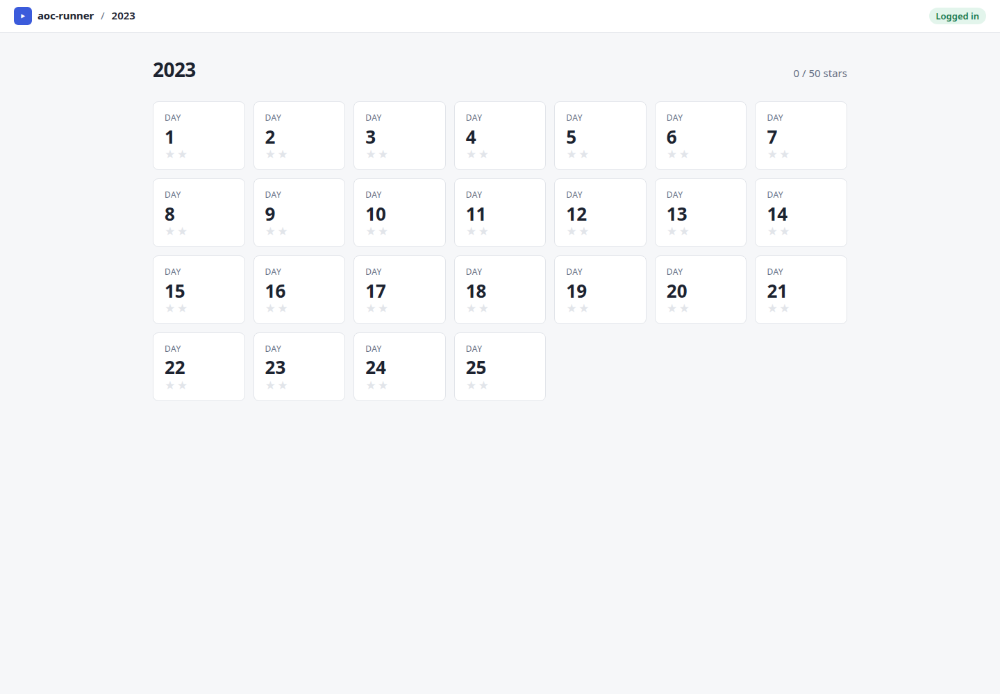

# aoc-runner

A local workbench for [Advent of Code](https://adventofcode.com). Browse events, read a puzzle, write a solution in the browser, run it against the examples or your own input, and submit the answer without leaving the page.



## Features

- **Seven languages:** Go, Haskell, Java, Odin, Python, Rust and TypeScript. Each one is compiled and run with its real toolchain.
- **Puzzle fetching:** the puzzle text, the example inputs and the expected example answers are pulled from adventofcode.com.
- **Your account:** your AoC session cookie is read straight from your browser via [kooky](https://github.com/browserutils/kooky), so stars, personal input and submissions all work without copying tokens around.
- **Answer checking:** part one and part two answers come back separately and are compared against the example answers before you submit.
- **Useful errors:** compiler and runtime errors point at the lines you wrote, not the generated wrapper code.
- **Submission history:** submissions are stored locally, and an answer AoC already marked incorrect isn't sent again.

## Requirements

- Go 1.26+
- Node.js 22+ (only to build the web UI)
- The toolchains for whichever languages you want to use:

| Language   | Needs on `PATH`       |
|------------|-----------------------|
| Go         | `go`                  |
| Haskell    | `ghc`                 |
| Java       | `javac`, `java`       |
| Odin       | `odin`                |
| Python     | `python3`             |
| Rust       | `rustc`               |
| TypeScript | `tsc`, `node`         |

You can leave out any toolchain you don't need. Only that language will fail.

## Getting started

The quickest way is the start script. It builds the UI, installs `aoc-runner` into your Go bin directory with `go install`, and starts the server:

```sh
./start.sh
```

Any arguments are passed through to `aoc-runner http`. To do the same steps by hand:

```sh
# build the web UI, it's embedded into the binary
go generate ./ui

# build and start the server
go build -o aoc-runner .
./aoc-runner http
```

Then open <http://localhost:8080>.

To link your account, log in to adventofcode.com in your normal browser, then click **Log in** in the top right of aoc-runner. The server reads the session cookie from your browser profile. Nothing is sent anywhere except adventofcode.com.

### UI development

```sh
./aoc-runner http      # API on :8080
cd ui && npm run dev   # Vite dev server, proxies /events, /submit and /auth to :8080
```

## Writing a solution

Every language uses the same shape: one function per part. Each function receives the puzzle input and returns the answer as a string. For example, in Python:

```python
class Solution:
    def part_one(self, reader):
        return ""

    def part_two(self, reader):
        return ""
```

The editor starts with the equivalent template when you switch languages.

## Configuration

Settings are read from `~/.aoc-runner/config.yaml`, or from a file passed with `--config`.

| Key               | Default          |
|-------------------|------------------|
| `server.host`     | `localhost:8080` |
| `server.database` | `~/aoc.db`       |

## API

The web UI is a thin client over a JSON API, so you can script against it too.

| Method | Path                              | Description                                     |
|--------|-----------------------------------|-------------------------------------------------|
| GET    | `/events/`                        | All years, with star counts when logged in      |
| GET    | `/events/:year`                   | Days of a year, with star counts                |
| GET    | `/events/:year/:day`              | Puzzle body, example inputs and answers         |
| GET    | `/events/:year/:day/input`        | Your personal input (requires login)            |
| POST   | `/events/:year/:day/answer`       | Submit an answer to AoC                         |
| GET    | `/submit/languages`               | Supported languages and their starter code      |
| POST   | `/submit/`                        | Build and run `{language, code, input}`         |
| GET    | `/auth/`                          | Session status                                  |
| POST   | `/auth/login`                     | Read the session cookie from the browser        |
| POST   | `/auth/logout`                    | Forget the session (AoC stays logged in)        |

## Project layout

```
cmd/                cobra commands (root, http)
internal/runner/    language interface, build/run, error line mapping, one package per language
internal/puzzle/    scraping events, puzzles, stars, input and submissions
internal/session/   AoC session via browser cookies
internal/web/       echo handlers: events, submit, auth
internal/model/     gorm models (events, puzzles, submissions)
ui/                 React + Vite + Monaco front end, embedded with go:embed
```

## Testing

```sh
go test ./...
```

A language's tests are skipped if its toolchain isn't installed.

## Being a good citizen

All requests to adventofcode.com send the `aoc-runner/1.0` User-Agent. Personal inputs are cached locally after the first fetch. Puzzle text and inputs belong to Advent of Code, so please don't commit them to public repositories.
